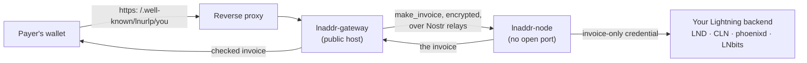

<div align="center">

<picture>
  <source media="(prefers-color-scheme: dark)" srcset="https://deadhop.run/docs/mark-fog.svg">
  
</picture>

# deadhop lnaddr

A Lightning address (`you@yourdomain.com`) for a node with no public address.

[](https://github.com/deadhop/lnaddr/actions/workflows/ci.yml)
[](#develop)
[](LICENSE)
[](https://deadhop.run/docs/lnaddr/)

</div>

A Lightning address (LUD-16) is a web endpoint: a wallet fetches
`https://yourdomain/.well-known/lnurlp/you`, then calls back for an invoice. From a node at home,
that usually means a VPN, a tunnel or a forwarded port, and each gives your node's network a way
in. lnaddr splits the job in two:

- **`lnaddr-node`** runs next to your Lightning node (LND, Core Lightning, phoenixd or LNbits).
  It opens no port. It answers invoice requests over [ContextVM](https://contextvm.org) (MCP
  over Nostr), end-to-end encrypted, only from the keys you list, with an invoice-only
  credential.
- **`lnaddr-gateway`** runs on any public host, behind any reverse proxy. It serves
  `/.well-known/lnurlp/<name>` from a cache, asks your node for each invoice over Nostr, and
  checks every invoice before a wallet sees it: amount, description hash, network, expiry and,
  optionally, your node's pinned key.



Lookups are answered from the gateway's cache in under a millisecond. An invoice takes one
round trip through the relays (170 to 280 ms on public relays in the
[performance](https://deadhop.run/docs/lnaddr/performance.html) runs), plus your backend's own
time.

What a wallet sees, here from the demo stage:

```text
$ curl -s http://127.0.0.1:8090/.well-known/lnurlp/alice | jq
{
  "tag": "payRequest",
  "callback": "http://lnaddr.example/.well-known/lnurlp/alice/callback",
  "minSendable": 1000,
  "maxSendable": 1000000000,
  "metadata": "[[\"text/plain\",\"Pay alice\"],[\"text/identifier\",\"alice@lnaddr.example\"]]"
}

$ curl -s "http://127.0.0.1:8090/.well-known/lnurlp/alice/callback?amount=21000" | jq
{
  "pr": "lnbcrt210n1p4s277xhp5yeppkn3y0cj78prp8z04qv3sdus5ff2wwt04pswv8xd4kn4xz5dqpp5…",
  "routes": []
}

$ curl -s "http://127.0.0.1:8090/.well-known/lnurlp/alice/callback?amount=1" | jq
{
  "status": "ERROR",
  "reason": "amount must be 1000 to 1000000000 msat"
}
```

## Quick start

There are no published images yet. Build both from this repository:

```sh
git clone https://github.com/deadhop/lnaddr && cd lnaddr
docker build --target node    -t deadhop-lnaddr-node .
docker build --target gateway -t deadhop-lnaddr-gateway .
# or, with Rust 1.88 or newer:
cargo build --release                       # target/release/lnaddr-node, lnaddr-gateway
```

Each image is one static (musl) binary on `scratch`, about 8 MB, with rustls and compiled-in
web roots: no OpenSSL or system TLS.

Each side needs the other's public key:

```sh
# on the public host
lnaddr-gateway pubkey                       # the npub to give your node
LNADDR_GATEWAY_DOMAIN=yourdomain.com LNADDR_GATEWAY_NODE=npub1node… lnaddr-gateway

# next to the Lightning node
lnaddr-node pubkey                          # the npub to give your gateway
LNADDR_NODE_BACKEND=lnd LNADDR_NODE_BACKEND_SECRET_FILE=invoice.macaroon \
LNADDR_NODE_BACKEND_TLS_CERT_FILE=tls.cert LNADDR_NODE_GATEWAYS=npub1gw… \
LNADDR_NODE_ADDRESSES=you lnaddr-node
```

The full walk-through, with TLS and a reverse proxy, is the
[quick start](https://deadhop.run/docs/lnaddr/quickstart.html).

**Configuration** comes in layers: values built in at compile time (`LNADDR_NODE_BUILTIN`,
`LNADDR_GATEWAY_BUILTIN`), a TOML file (`--config`), environment variables, and, on the node if
you turn it on, address, limit, relay and proxy changes from an admin key over ContextVM. Any
layer can lock the later ones out.

**Relays and proxies** for both run on deadhop's network engine (`crates/netengine` in
[deadhop/server](https://github.com/deadhop/server)): routing rules, proxy groups, relay health
and a privacy audit. You manage them from the network console (`console/` in
[deadhop/js](https://github.com/deadhop/js)) with an admin key.

## The gateway's admin interface

An optional web interface on its own listener (loopback by default), with a CLI that does the
same: nodes, addresses, invoice counts and timings, and recent failures.

<p align="center">
  <picture>
    <source media="(prefers-color-scheme: light)" srcset="https://deadhop.run/shots/lnaddr-overview-light.webp">
    
  </picture>
</p>

## Try it without a Lightning node

`demo/` is a local stage: a Nostr relay on `ws://127.0.0.1:7788`, and a fake LND on
`http://127.0.0.1:18080` (macaroon `demo`) that signs real regtest invoices.

```sh
(cd demo && cargo run --release)
```

Then run the two real binaries against it, with `network = "regtest"`,
`LNADDR_NODE_BACKEND_URL=http://127.0.0.1:18080`, `LNADDR_NODE_BACKEND_SECRET=demo` and the
relay above.

## Documentation

The guides are at [deadhop.run/docs/lnaddr](https://deadhop.run/docs/lnaddr/). Their source is
in [deadhop/site](https://github.com/deadhop/site) under `docs/lnaddr/`; send doc fixes there.

| Page | What it covers |
| --- | --- |
| [Quick start](https://deadhop.run/docs/lnaddr/quickstart.html) | Both binaries, their keys, a first payment |
| [Connect your Lightning backend](https://deadhop.run/docs/lnaddr/backends.html) | LND, Core Lightning, phoenixd, LNbits, and the invoice-only credential for each |
| [Put it behind a reverse proxy](https://deadhop.run/docs/lnaddr/reverse-proxies.html) | Caddy, nginx, Traefik |
| [Manage it from the web or CLI](https://deadhop.run/docs/lnaddr/admin.html) | The admin interface and commands |
| [Architecture](https://deadhop.run/docs/lnaddr/architecture.html) | The split, the node's tools, one payment step by step, the configuration layers |
| [Hardening](https://deadhop.run/docs/lnaddr/hardening.html) / [Security](https://deadhop.run/docs/lnaddr/security.html) | Limits, what each party can see and do, what lnaddr cannot stop |
| [Performance](https://deadhop.run/docs/lnaddr/performance.html) / [Testing](https://deadhop.run/docs/lnaddr/testing.html) | The measurements, and what the tests cover |
| [Node](https://deadhop.run/docs/lnaddr/node.html) / [Gateway](https://deadhop.run/docs/lnaddr/gateway.html) configuration | Every setting, and how the layers lock |

## Develop

Requirements: Rust 1.99, [`just`](https://github.com/casey/just) and
[`cargo-llvm-cov`](https://github.com/taiki-e/cargo-llvm-cov).

```sh
just check                  # fmt, clippy -D warnings, tests with 100% line and function coverage
just update-server-crates   # move the shared crates to the newest deadhop/server main
```

The shared crates (`deadhop-tlspin`, `-cvm`, `-net`, `-common`, `-netengine`) and a patched
`rmcp` come from [deadhop/server](https://github.com/deadhop/server) through git, pinned by
`Cargo.lock`.

| Path | What |
| --- | --- |
| `src/node/` | The node: config layers, backends, the MCP tools, its network (relays and proxies on the network engine), the request loop, the CLI |
| `src/gateway/` | The gateway: config, node directory and cache, public HTTP, admin web, its network, the console's ContextVM server, the CLI |
| `src/lnurl.rs`, `src/bolt11.rs` | LUD-06/12/16, and the invoice checks both sides share |
| `src/pool.rs`, `src/cvm.rs`, `src/handshake.rs` | The relay pool (first OK wins), a stateless ContextVM client, the local MCP handshake |
| `src/files.rs`, `src/tls.rs`, `src/settings.rs`, `src/ratelimit.rs` | Private files, pinned TLS, config parsing, rate limits |
| `demo/` | The local stage: a relay and a fake LND |
| `assets/brand/` | Copies of the brand's fonts, mark and favicon (originals in [deadhop/brand](https://github.com/deadhop/brand)) |

## Agent skills

This repository ships [agent skills](https://deadhop.run/docs/skills.html) for Claude Code,
Codex, Cursor and other agents that read `SKILL.md`:

```sh
npx skills add deadhop/lnaddr
```

| Skill | Use it to |
| --- | --- |
| `deadhop-lnaddr-setup` | set up a Lightning address: `lnaddr-node` next to LND, Core Lightning, phoenixd or LNbits, `lnaddr-gateway` behind a reverse proxy, and check it end to end |
| `deadhop-lnaddr-develop` | change lnaddr: `just check` at 100% coverage, the shared crates from deadhop/server, the brand copies, the demo stage |

Install one with `--skill <name>`. Every deadhop skill is listed on
[Agent skills](https://deadhop.run/docs/skills.html).

## Contributing

Issues and pull requests are welcome here. CI runs `just check` on every pull request; run it
before you push. Doc changes go to [deadhop/site](https://github.com/deadhop/site).

## License

[MIT](LICENSE).
